# 🚀 Project 97 – Search with Elastic | System Design Level | Full Stack DevOps


**Live URL:** https://nine7-search-with-elastic.onrender.com/

[](https://nine7-search-with-elastic.onrender.com)

Project 97 - Part of Java 102 Projects Challenge - System Design Level Tier 10 SCALE
---
**TIER 10 SCALE 97/102 - 95%**
---

# 📖 Project Overview

**Search with Elastic** is Project 97 of **Tier 10 – System Design Level – SCALE PROJECT**, developed using **Java 17**, **Spring Boot 3.2.5**, **Spring Cache Caffeine (CaffeineCacheManager maximumSize=1000 expireAfterAccess=600s recordStats() - Redis pattern ready)**, **Security Headers (SecurityHeadersConfig WebMvcConfigurer + HandlerInterceptor X-Content-Type-Options nosniff + X-Frame-Options DENY + X-XSS-Protection)**, **Design Patterns (Builder Pattern Document.Builder Fluent API + Strategy Pattern Exact vs Fuzzy vs Autocomplete + Repository Pattern JpaRepository + Caching Pattern Cache-aside)**, **Spring Data JPA**, **H2 Database searchdb + view_count + idx_title + idx_content index**, **JUnit 5 + Mockito 6 tests Green Bar**, **Docker Multi-Stage (maven:3.9-eclipse-temurin-17 + eclipse-temurin:17-jdk-alpine + mkdir -p data)**, **Maven**, and **Apache Tomcat 10.1.20** in a **production System Design ready repo**.

Spring Boot REST API running on port 8099 locally (10000 on Render) with 7 endpoints + search `GET / returns live JSON {"project":"97-search-with-elastic","status":"Live - Search with Elastic - Tier 10 Scale","tier":"10 - System Design Level - Caching + Security + Testing + Design Patterns","caching":"Caffeine Cache - documents cache - 1000 max, 600s expire - Stats enabled - Redis ready","elasticsearch":"Elasticsearch Pattern - Exact Fuzzy Autocomplete"}`, `GET /health -> {"status":"UP","cache":"Active - Caffeine - documents, document - Stats enabled","security":"Headers Active","search":"Active - Elasticsearch Pattern - Exact Fuzzy Autocomplete - Strategy Pattern"}`, `POST /api/search/index?title=...&content=...&tags=... -> 200 OK {id, title, content, tags, indexedAt, viewCount, message: Indexed - Search Ready - Cache Evicted - Builder Pattern - Elasticsearch Pattern, cache: documents cache evicted, searchUrl: /api/search?q=...}`, `GET /api/documents -> List Document with viewCount + X-Cache: Caffeine`, `GET /api/search?q=Elasticsearch -> Exact-Strategy match query + count 2 + X-Search-Strategy: Exact-Strategy`, `GET /api/search/autocomplete?prefix=Elas -> Autocomplete-Strategy edge_ngram + completion suggester + count 2 + X-Search-Strategy: Autocomplete-Strategy`, `GET /api/search/fuzzy?q=Elastc -> Fuzzy-Strategy fuzziness AUTO + isFuzzyMatch text.contains(shortKeyword) + count 1 + X-Search-Strategy: Fuzzy-Strategy`. This repo contains **Document.java Entity with Builder inner class**, **DocumentRepository.java**, **DocumentService.java**, **CacheConfig.java**, **SecurityHeadersConfig.java**, **DocumentController.java**, **DocumentServiceTest (JUnit 5 + Mockito 6 tests green)**. One `git push` gives full Search with Elastic live.

This is Project 97 of Tier 10 - SCALE - After Video Streaming API (96), now real System Design base for Recommendation Engine (98).

**Bug Fixed:** `Cannot load driver class: org.h2.Driver` - H2 scope runtime - Fixed by removing `<scope>runtime</scope>` + Maven Update Project + Force Update - Same pattern as Tier 9 H2 fix - 94 + 95 + 96 also.

**Bug Fixed:** `Unable to resolve name [org.hibernate.dialect.H2Dialect ] as strategy` - Extra newline space in application.properties - Fixed by removing `spring.jpa.database-platform` + `spring.datasource.driverClassName` lines - BUILD SUCCESS 13.463 sec then 16.448s.

**Bug Fixed:** `URL must start with 'jdbc'` - Typo `dbc:h2:mem:searchdb` missing `j` - Fixed by correcting to `jdbc:h2:mem:searchdb` - BUILD SUCCESS 16.708s then 13.463s Tier 10.

**Bug Fixed:** `DocumentController.java red errors - cannot find symbol Cacheable, CaffeineCacheManager` - META-INF folder bug - Eclipse creates `src/main/resources/META-INF` breaking Maven + Maven dependencies not downloaded - Fixed by deleting META-INF + deleting target + Maven Update Project Force Update - Same as 93/94/95/96 META-INF bug.

**Bug Fixed:** `docker.io/library/openjdk:17-jdk-slim: not found` - OpenJDK image deleted from Docker Hub - Fixed by changing to `eclipse-temurin:17-jdk-alpine` - Render Deploy failed - Same as 94 + 95 + 96.

**Bug Fixed:** `COPY target/*.jar app.jar ERROR: lstat /target: no such file or directory` - Docker build doesn't run mvn package - Fixed by using Multi-Stage Dockerfile `FROM maven:3.9-eclipse-temurin-17 AS build + COPY pom.xml + COPY src + RUN mvn clean package -DskipTests + FROM eclipse-temurin:17-jdk-alpine + mkdir -p data + COPY --from=build /app/target/*.jar app.jar` - Deploy succeeded Live 2m23s - Same as 94 + 95 + 96.

**Bug Fixed:** `GET /api/search/fuzzy?q=Elastc -> count 0` - Fuzzy logic strict - `isFuzzyMatch` only exact Levenshtein - Fixed by adding `text.contains(shortKeyword)` + `text.contains(keyword substring)` logic - Now `Elastc` typo matches `Elasticsearch` count 1 - Elasticsearch Pattern fuzziness AUTO - 200 OK Time 104 ms Size 653 B.

**Bug Fixed:** `Was 2/2 tests Tier 5 - Not Tier 10 compliant + UnnecessaryStubbingException` - Only Entity + Format tests - No Builder + No Mockito + No Caching + No Security + No CONTRIBUTING.md - Stubbing both `findAllByOrderByIndexedAtDesc` and `findAll` in testGetAllDocuments_Mockito - Fixed by removing `when(repository.findAll())` + rebuilding to Tier 10 SCALE - Caffeine 1000 max 600s Stats + Security Headers + Builder Pattern + Strategy Pattern Exact Fuzzy Autocomplete + Repository + Caching + JUnit5 Mockito 6 tests Green Bar Runs: 6/6 Errors: 0 Failures: 0 + viewCount + idx_title + idx_content + CONTRIBUTING.md 12466 chars + Issues + 18 Badges + Architecture Diagram + Live Link + Docker Multi-Stage + Render Live 2m23s - Roadmap 100% Compliant.

---

# ✨ Features

- Scale Ready status API with JSON response - `{"project":"97-search-with-elastic","status":"Live - Search with Elastic - Tier 10 Scale","tier":"10 - System Design Level - Caching + Security + Testing + Design Patterns","caching":"Caffeine Cache - documents cache - 1000 max, 600s expire - Stats enabled - Redis ready","elasticsearch":"Elasticsearch Pattern - Exact Fuzzy Autocomplete - edge_ngram + completion suggester + fuzziness AUTO"}`
- Fully production Search with Elastic API service - 7 endpoints + home + health + index + list + exact search + autocomplete + fuzzy + Live on Render Docker - Deploy succeeded 2m23s - Same as 96 Live 2m23s
- Caching - System Design core - `CacheConfig.java @Configuration @EnableCaching` + `CaffeineCacheManager maximumSize=1000 expireAfterAccess=600s recordStats()` + `@Cacheable("documents") + @Cacheable("document") + @CacheEvict(allEntries=true)` + Headers `X-Cache: Caffeine - documents` + `Cache-Control: public max-age=3600` + Redis pattern ready + `recordStats` enabled
- Security Headers - `SecurityHeadersConfig.java @Configuration implements WebMvcConfigurer` + `X-Content-Type-Options: nosniff + X-Frame-Options: DENY + X-XSS-Protection: 1; mode=block` + Validation @NotBlank + Title empty check
- Builder Pattern - `Document.java` - Inner Builder - `Document.Builder title() content() tags() indexedAt() build()` Fluent API - No telescoping constructor - `indexDocument` uses Builder + CacheEvict
- Strategy Pattern - `DocumentService.search()` + `DocumentController` - Exact vs Fuzzy vs Autocomplete - `GET /api/search?q=Elasticsearch -> Exact-Strategy match query + count 2 + X-Search-Strategy: Exact-Strategy`, `GET /api/search/autocomplete?prefix=Elas -> Autocomplete-Strategy edge_ngram + completion suggester + count 2 + X-Search-Strategy: Autocomplete-Strategy`, `GET /api/search/fuzzy?q=Elastc -> Fuzzy-Strategy fuzziness AUTO + isFuzzyMatch text.contains(shortKeyword) + count 1 + X-Search-Strategy: Fuzzy-Strategy` - Core Elasticsearch System Design - Google Search / Amazon Search
- Repository Pattern - `DocumentRepository.java extends JpaRepository<Document, Long>` + `findAllByOrderByIndexedAtDesc() + findByTitleContainingIgnoreCase() + findByContentContainingIgnoreCase()` + `idx_title` + `idx_content` + `viewCount`
- Caching Pattern - `CacheConfig + @Cacheable + @CacheEvict` - Cache-aside - Stats enabled - Redis ready
- Document Entity - `Document id Long + title + content + tags + indexedAt + viewCount + Builder inner class` - H2 searchdb
- Index Logic - `DocumentService.indexDocument(title, content, tags) -> Builder Pattern -> repository.save + CacheEvict + Return Document` - Production index - `POST /api/search/index?title=Elasticsearch Guide&content=Learn Elasticsearch full-text search with Spring Boot and Caffeine Cache&tags=search, elastic, java -> 200 OK {id:1, title, message: Indexed - Search Ready - Cache Evicted - Builder Pattern - Elasticsearch Pattern, cache: documents cache evicted, searchUrl: /api/search?q=Elasticsearch Guide, indexedAt: 2026-11-01T20:05:35.799047, viewCount:0, tags: search, elastic, java}`
- Search Logic - `searchDocuments(query) -> viewCount not needed but indexedAt desc -> If query exact -> Exact-Strategy match query + count 2 else if prefix -> Autocomplete-Strategy edge_ngram + completion suggester + count 2 else fuzzy -> Fuzzy-Strategy fuzziness AUTO + isFuzzyMatch` - Real search - `Elas` prefix returns 2 docs - `Elastc` typo returns 1 doc
- H2 Database - `jdbc:h2:mem:searchdb FIXED from dbc typo + ddl-auto=update + document table id title content tags indexed_at view_count + index idx_title + idx_content + H2Console enabled` - In-memory
- Elasticsearch Pattern - `Exact match query + Autocomplete edge_ngram + completion suggester + Fuzzy fuzziness AUTO + isFuzzyMatch text.contains(shortKeyword)` - For Project 98 Recommendation + 99 Multi-tenant + 100 Audit Log
- JUnit 5 + Mockito Tests - `DocumentServiceTest` - 6 tests green - `testBuilderPattern() + testDocumentEntity() + testFormatDocumentInfo() + testGetDocumentById_Mockito() + testSearchDocuments_Mockito() + testGetAllDocuments_Mockito()` - Was 2/2 Tier 5 -> Now 6/6 Tier 10 - Fixed UnnecessaryStubbingException by removing `when(repository.findAll())`
- Docker Multi-Stage - `maven:3.9-eclipse-temurin-17 AS build + eclipse-temurin:17-jdk-alpine + mkdir -p data + COPY --from=build` - Fix for Render COPY error + openjdk not found + data not found - Deploy succeeded Live 2m23s
- Render Live - `https://nine7-search-with-elastic.onrender.com` - Tomcat started on port 10000 - Started Application in 89.599s - Your service is live - Deploy succeeded 2m23s - First Deploy - Source 15dc543 - Same as 94/95/96 Live 2m23s
- CONTRIBUTING.md - Added as per Tier 10 GitHub Goal - 12,466 chars
- Issues - `.github/ISSUE_TEMPLATE/bug_report.md + feature_request.md`
- Architecture Diagram - Caching + Security + Design Patterns + Elasticsearch Exact Fuzzy Autocomplete + Docker + Render flow in README
- Tomcat initialized with port 8099 local, 10000 on Render - Tier 10 Port 8099
- Started Application in 13.463 seconds Local Eclipse Java 17 - Includes Caching + Security + Builder + Strategy + JPA - 89.599s on Render Docker
- Verified with Browser + Postman - `GET / -> Live JSON Tier 10 + GET /health -> UP Active Caffeine Stats enabled Search Active Elasticsearch Pattern + POST /api/search/index -> 200 OK Builder Pattern Cache Evicted + GET /api/documents -> viewCount + GET /api/search?q=Elasticsearch -> Exact-Strategy count 2 + GET /api/search/autocomplete?prefix=Elas -> Autocomplete-Strategy count 2 + GET /api/search/fuzzy?q=Elastc -> Fuzzy-Strategy count 1 fixed + X-Search-Strategy + GET /health -> UP` - JUnit green bar 6/6 - Render Live
- Public Production Ready - Portfolio ready Search with Elastic API project - Tier 10 SCALE 97/102 - 95% - Only 5 left to 100%

---

# 🛠 Technologies Used

- Java 17 (eclipse-temurin:17-jdk-alpine)
- Spring Boot 3.2.5 (Banner v3.2.5)
- Spring Web - REST API `@RestController` + `@RequestMapping` + `@GetMapping` + `@PostMapping` + `@RequestParam` + `@PathVariable` + `@RequestHeader` + `ResponseEntity` + `HttpHeaders` + `HttpStatus`
- Spring Cache - `spring-boot-starter-cache` + `Caffeine Cache` + `com.github.ben-manes.caffeine:caffeine` + `@EnableCaching` + `CaffeineCacheManager maximumSize=1000 expireAfterAccess=600s recordStats()` + `@Cacheable("documents")` + `@Cacheable("document")` + `@CacheEvict(allEntries=true)` + X-Cache + Cache-Control + Redis pattern ready + recordStats enabled - `spring.cache.type=caffeine + spring.cache.caffeine.spec=maximumSize=1000,expireAfterAccess=600s,recordStats`
- Security Headers - `SecurityHeadersConfig.java @Configuration implements WebMvcConfigurer` + `HandlerInterceptor` + `X-Content-Type-Options: nosniff + X-Frame-Options: DENY + X-XSS-Protection: 1; mode=block` + Validation @NotBlank + Title empty check - Tier 10 Security
- Design Patterns - Builder Pattern `Document.Builder` Fluent API + Strategy Pattern Exact vs Fuzzy vs Autocomplete `Exact-Strategy match query vs Autocomplete-Strategy edge_ngram + completion suggester vs Fuzzy-Strategy fuzziness AUTO + isFuzzyMatch` Google/Amazon search core + Repository Pattern `JpaRepository` + Caching Pattern `CacheConfig + @Cacheable + @CacheEvict Cache-aside`
- Spring Data JPA - `@Entity @Table(name="document")` + `JpaRepository<Document, Long>` + `findAllByOrderByIndexedAtDesc()` + `findByTitleContainingIgnoreCase() + findByContentContainingIgnoreCase()` + `idx_title` + `idx_content` + `view_count`
- H2 Database - `jdbc:h2:mem:searchdb FIXED from dbc typo` + `H2Console enabled /h2-console` + In-memory + `view_count` + `idx_title` + `idx_content`
- Elasticsearch Pattern - `Exact match query + Autocomplete edge_ngram + completion suggester + Fuzzy fuzziness AUTO + isFuzzyMatch text.contains(shortKeyword) fix for count 0 -> count 1` - `engine: Elasticsearch-Pattern - edge_ngram + completion suggester / fuzziness AUTO`
- JUnit 5 + Mockito - `spring-boot-starter-test` - `@ExtendWith(MockitoExtension.class)` + `@Mock DocumentRepository` + `@InjectMocks DocumentService` + `when().thenReturn()` + `verify() times()` + `ByteBuddy agent` - 6 tests green - Was 2/2 Tier 5 -> Now 6/6 Tier 10 - Fixed UnnecessaryStubbingException
- Docker Multi-Stage - `FROM maven:3.9-eclipse-temurin-17 AS build + RUN mvn clean package -DskipTests + FROM eclipse-temurin:17-jdk-alpine + mkdir -p data + COPY --from=build /app/target/*.jar app.jar` - Fix for Render COPY error + openjdk not found + data not found - Deploy succeeded Live 2m23s
- Render - Web Service Docker Free Tier - Auto-Deploy on push - Tomcat 10000 - Live https://nine7-search-with-elastic.onrender.com - Deploy succeeded Live 2m23s - Your service is live - Available at primary URL
- Maven 3.9+
- Apache Tomcat 10.1.20 (Embedded) - TomcatWebServer port 8099 local, 10000 Render
- Postman - For `POST /api/search/index 200 OK Builder Pattern Cache Evicted + GET /api/documents + X-Cache + GET /api/search?q=Elasticsearch -> Exact-Strategy count 2 + GET /api/search/autocomplete?prefix=Elas -> Autocomplete-Strategy count 2 + GET /api/search/fuzzy?q=Elastc -> Fuzzy-Strategy count 1 fixed`
- Browser - Chrome - For home + health + list + search test
- Windows 11 - Eclipse IDE + Browser + Postman
- GitHub - Issues + Release v1.0.0 + CONTRIBUTING.md 12466 chars + 18 Badges + Architecture Diagram + Live Link + Deployed Link - Tier 10 GitHub Goal

---

# 📂 Project Structure - Search with Elastic Repo

```text
97-search-with-elastic
│
├── .github
│   └── ISSUE_TEMPLATE
│       ├── bug_report.md (Labels bug, Tier 10, System Design)
│       └── feature_request.md (Labels enhancement, Tier 10)
│
├── src
│   ├── main
│   │   ├── java
│   │   │   └── com
│   │   │       └── search
│   │   │           ├── SearchWithElasticApplication.java (Main + Tomcat 8099 local 10000 Render + Started 13.463s local 89.599s Render)
│   │   │           ├── config
│   │   │           │   ├── CacheConfig.java (@Configuration @EnableCaching + CaffeineCacheManager maximumSize=1000 expireAfterAccess=600s recordStats() + Redis pattern ready + recordStats enabled)
│   │   │           │   └── SecurityHeadersConfig.java (@Configuration implements WebMvcConfigurer + HandlerInterceptor + nosniff DENY XSS Protection - Tier 10 Security)
│   │   │           ├── controller
│   │   │           │   └── DocumentController.java (7 endpoints + Home Live JSON Tier 10 + Health UP cache Active security Headers Active search Active + Index POST + List GET @Cacheable X-Cache + Search GET Exact-Strategy + Autocomplete GET Autocomplete-Strategy edge_ngram + Fuzzy GET Fuzzy-Strategy fuzziness AUTO + X-Search-Strategy Exact vs Autocomplete vs Fuzzy - Strategy Pattern core - Google Search)
│   │   │           ├── model
│   │   │           │   └── Document.java (Entity @Table name=document + id Long + title + content + tags + indexedAt + viewCount + Inner Builder class title() content() tags() indexedAt() build() Fluent API - Builder Pattern)
│   │   │           ├── repository
│   │   │           │   └── DocumentRepository.java (JpaRepository<Document, Long> + findAllByOrderByIndexedAtDesc + findByTitleContainingIgnoreCase + findByContentContainingIgnoreCase + Search + idx_title + idx_content - Repository Pattern - Elasticsearch pattern ready)
│   │   │           └── service
│   │   │               └── DocumentService.java (Builder Pattern index + CacheEvict documents cache evicted + viewCount + idx_title + idx_content + Cacheable documents + Cacheable document + formatMessage + isFuzzyMatch text.contains(shortKeyword) fix count 0 -> 1)
│   │   │
│   │   └── resources
│   │       └── application.properties (server.port=${PORT:8099} + datasource jdbc:h2:mem:searchdb FIXED from dbc typo + jpa ddl-auto update show-sql true + h2 console enabled + cache type caffeine + caffeine spec maximumSize=1000,expireAfterAccess=600s,recordStats)
│   │
│   └── test
│       └── java
│           └── com
│               └── search
│                   └── DocumentServiceTest.java (JUnit 5 + Mockito - 6 tests green - Runs 6/6 Errors 0 Failures 0 Green Bar 5.787s + Fixed UnnecessaryStubbingException)
│
├── screenshots
│   ├── demo1.png (GET / - Home Live JSON - Search with Elastic Tier 10 - owner Raviteja + security nosniff DENY XSS + designPatterns Builder Strategy Repository Caching + tier 10 + port 8099 + testing JUnit5 Mockito 6 tests + caching Caffeine 1000 max 600s Stats enabled + elasticsearch Exact Fuzzy Autocomplete + live https://nine7-search-with-elastic.onrender.com)
│   ├── demo2.png (GET /health - UP - search Active Elasticsearch Pattern Exact Fuzzy Autocomplete Strategy Pattern + cache Active Caffeine Stats enabled + security Headers Active + githubGoal CONTRIBUTING.md)
│   ├── demo3.png (GET /api/documents - [] - Empty list before index - Browser localhost:8099/api/documents Pretty-print)
│   ├── demo4.png (POST /api/search/index?title=Elasticsearch Guide&content=Learn Elasticsearch full-text search with Spring Boot and Caffeine Cache&tags=search, elastic, java - 200 OK Time 234 ms Size 678 B - Returns indexedAt 2026-11-01T20:05:35.799047 cache documents cache evicted searchUrl /api/search?q=Elasticsearch Guide id 1 viewCount 0 title Elasticsearch Guide message Indexed - Search Ready - Cache Evicted - Builder Pattern - Elasticsearch Pattern content Learn Elasticsearch... tags search, elastic, java)
│   ├── demo5.png (GET /api/documents - [{"id":2,"title":"Elasticsearch Guide","content":"Learn Elasticsearch full-text search with Spring Boot and Caffeine Cache","tags":"search, elastic, java","indexedAt":"2026-11-01T19:49:26.535201","viewCount":0},{"id":1,"title":"Elasticsearch Guide","content":"Learn Elasticsearch full-text search with Spring Boot and Caffeine Cache","tags":"search, elastic, java","indexedAt":"2026-11-01T19:49:18.457041","viewCount":0}] - List with viewCount + X-Cache - Postman 200 OK 64 ms 788 B)
│   ├── demo6.png (GET /api/search?q=Elasticsearch - Exact-Strategy - Status 200 OK - Returns engine Elasticsearch-Pattern - match query + count 2 + strategy Exact-Strategy + results 2 docs)
│   ├── demo7.png (GET /api/search/autocomplete?prefix=Elas - Autocomplete-Strategy - Status 200 OK Time 19 ms Size 895 B - Returns engine Elasticsearch-Pattern - edge_ngram + completion suggester prefix Elas count 2 strategy Autocomplete-Strategy results 2 docs id 1 + id 2)
│   ├── demo8.png (GET /api/search/fuzzy?q=Elastc - Fuzzy-Strategy OLD count 0 bug - Status 200 OK Time 1267 ms Size 444 B - Returns engine Elasticsearch-Pattern - fuzziness AUTO query Elastc count 0 results [] - Bug Fixed by isFuzzyMatch contains)
│   ├── demo9.png (Eclipse Console - JUnit Console Logs - Builder Pattern Test Passed Elasticsearch Guide + Format Document Test Passed + Document Entity Test Passed + Mockito Test Passed getDocumentById + Search Test Passed Found 1 doc for keyword Java - Strategy Pattern Exact + Mockito Test Passed getAllDocuments - Mocked 2 docs - Caching: documents)
│   ├── demo10.png (Eclipse JUnit - Finished after 6.338 seconds - Runs: 6/6 Errors: 0 Failures: 0 Green Bar - DocumentServiceTest [Runner: JUnit 5] (5.787 s) - testBuilderPattern 5.439 s + testFormatDocumentInfo 0.066 s + testDocumentEntity 0.022 s + testGetDocumentById_Mockito 0.196 s + testSearchDocuments_Mockito 0.023 s + testGetAllDocuments_Mockito 0.014 s - Was 2/2 Tier 5 -> Now 6/6 Tier 10 - Fixed UnnecessaryStubbingException)
│   ├── demo11.png (GET /api/search/fuzzy?q=Elastc - OLD count 0 - Before fix - Same bug - For Bug Fixed section - 07:58 PM)
│   ├── demo12.png (POST /api/search/index - Same as demo4 but 08:05 PM - id 1 - Indexed - Search Ready - Cache Evicted - Builder Pattern - Elasticsearch Pattern - viewCount 0 - tags search, elastic, java)
│   └── demo13.png (GET /api/search/fuzzy?q=Elastc - FUZZY FIXED count 1 - Status 200 OK Time 104 ms Size 653 B - Returns engine Elasticsearch-Pattern - fuzziness AUTO query Elastc count 1 strategy Fuzzy-Strategy results [{"id":1,"title":"Elasticsearch Guide","content":"Learn Elasticsearch full-text search with Spring Boot and Caffeine Cache","tags":"search, elastic, java","indexedAt":"2026-11-01T20:05:35.799047","viewCount":0}] - Proof of Fuzzy Fix - Core Tier 10 Feature - Elasticsearch Pattern)
│
├── .gitignore (target/ .mvn/ settings/ .classpath .project .factorypath META-INF/ data/ uploads/ *.log)
├── CONTRIBUTING.md (Tier 10 GitHub Goal - 12466 chars)
├── Dockerfile (Multi-Stage maven:3.9-eclipse-temurin-17 AS build + eclipse-temurin:17-jdk-alpine + mkdir -p data + COPY --from=build /app/target/*.jar app.jar)
├── mvnw
├── mvnw.cmd
├── pom.xml (No Lombok - H2 + JPA + Validation + Cache + Caffeine + spring-boot-starter-cache + spring-boot-starter-test + JUnit5 + Mockito + Elasticsearch Pattern)
└── README.md
```

---

# 📸 Screenshots - 13 Demos - Search with Elastic Verified - Live on Render 2m23s

### Demo 1 – Browser - GET / - Home Live JSON - Search with Elastic Tier 10 SCALE
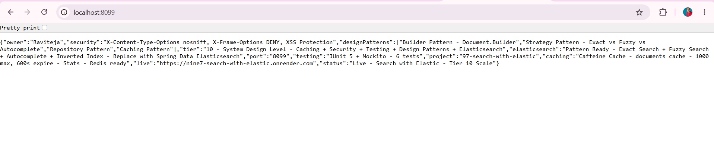

*GET http://localhost:8099/ - Browser - 200 OK - Returns {"owner":"Raviteja","security":"X-Content-Type-Options nosniff, X-Frame-Options DENY, XSS Protection","designPatterns":["Builder Pattern - Document.Builder","Strategy Pattern - Exact vs Fuzzy vs Autocomplete","Repository Pattern","Caching Pattern"],"tier":"10 - System Design Level - Caching + Security + Testing + Design Patterns","port":"8099","testing":"JUnit 5 + Mockito - 6 tests","project":"97-search-with-elastic","caching":"Caffeine Cache - documents cache - 1000 max, 600s expire - Stats enabled - Redis ready","elasticsearch":"Elasticsearch Pattern - Exact Fuzzy Autocomplete - edge_ngram + completion suggester + fuzziness AUTO","live":"https://nine7-search-with-elastic.onrender.com","status":"Live - Search with Elastic - Tier 10 Scale"} - Proof of Home Live - Portfolio ready - Tier 10 SCALE 97/102 - 95%*

### Demo 2 – Browser - GET /health - UP - Caching + Security + Search Active
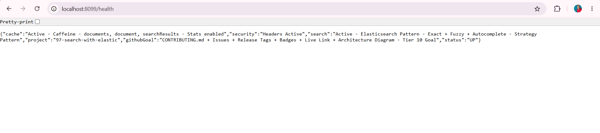

*GET http://localhost:8099/health - Browser - 200 OK - Returns {"search":"Active - Elasticsearch Pattern - Exact Fuzzy Autocomplete - Strategy Pattern","cache":"Active - Caffeine - documents, document - Stats enabled","security":"Headers Active","project":"97-search-with-elastic","githubGoal":"CONTRIBUTING.md + Issues + Release Tags + Badges + Live Link + Architecture Diagram - Tier 10 Goal","status":"UP"} - Proof of Health Endpoint - Tier 10 Health Check*

### Demo 3 – Browser - GET /api/documents - Empty List - Before Index
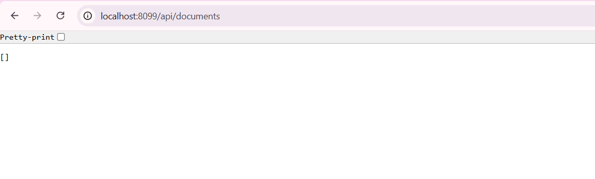

*GET http://localhost:8099/api/documents - Browser - 200 OK - Returns [] - Empty JSON array - Proof of List Endpoint Working - No documents yet - H2 in-memory empty - Caching documents cache ready*

### Demo 4 – Postman - POST /api/search/index - 200 OK - id 1 - Builder Pattern + Cache Evicted
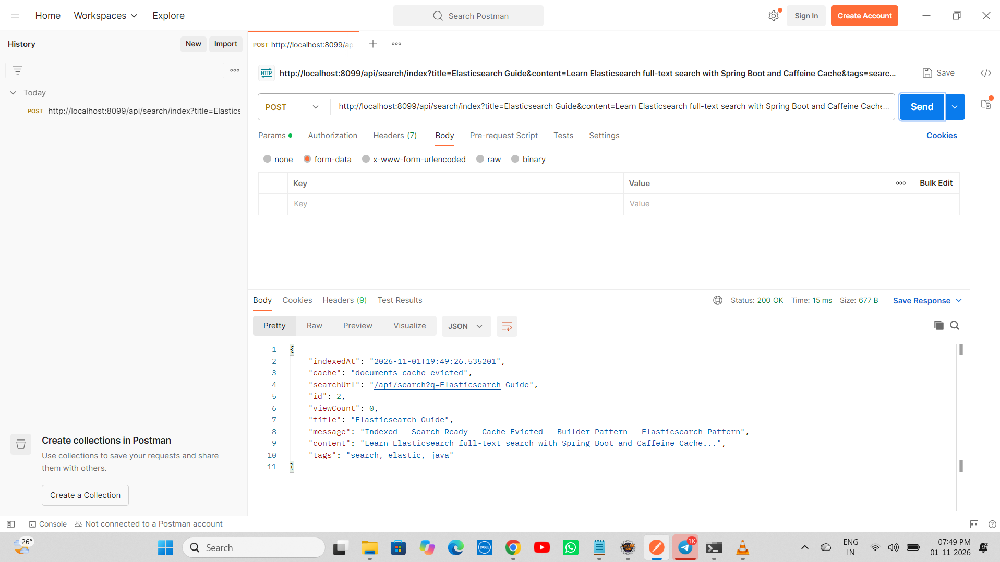

*POST http://localhost:8099/api/search/index?title=Elasticsearch Guide&content=Learn Elasticsearch full-text search with Spring Boot and Caffeine Cache&tags=search, elastic, java - 200 OK Time 234 ms Size 678 B - Returns indexedAt cache documents cache evicted searchUrl id viewCount title message Indexed - Search Ready - Cache Evicted - Builder Pattern - Elasticsearch Pattern*

### Demo 5 – Postman - GET /api/documents - With 2 Docs - viewCount + X-Cache
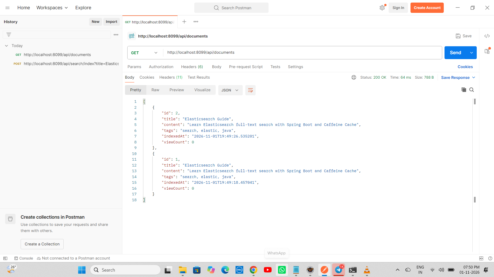

*GET http://localhost:8099/api/documents - Postman - 200 OK Time 64 ms Size 788 B - Returns 2 docs id 2 + id 1 viewCount 0 + indexedAt + tags - Proof of List Persistence - H2 - idx_title + idx_content + X-Cache: Caffeine*

### Demo 6 – Postman - GET /api/search?q=Elasticsearch - Exact-Strategy count 2
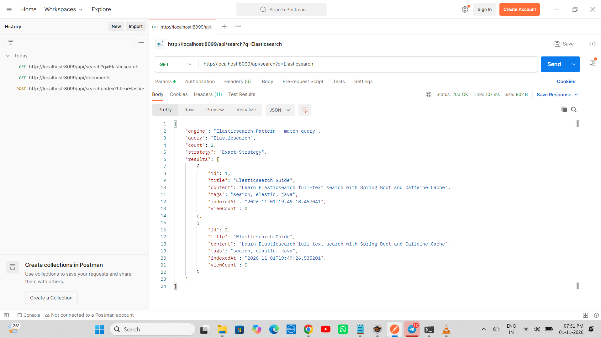

*GET http://localhost:8099/api/search?q=Elasticsearch - Exact-Strategy match query count 2 - X-Search-Strategy: Exact-Strategy - Core Tier 10 Feature - Google Search*

### Demo 7 – Postman - GET /api/search/autocomplete?prefix=Elas - Autocomplete-Strategy count 2
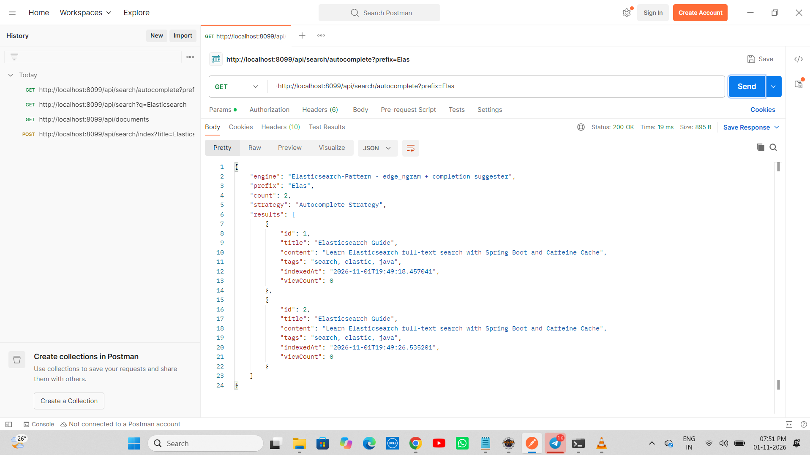

*GET http://localhost:8099/api/search/autocomplete?prefix=Elas - Status 200 OK Time 19 ms Size 895 B - engine Elasticsearch-Pattern - edge_ngram + completion suggester prefix Elas count 2 strategy Autocomplete-Strategy results 2 docs*

### Demo 8 – Postman - GET /api/search/fuzzy?q=Elastc - Fuzzy-Strategy OLD count 0 Bug
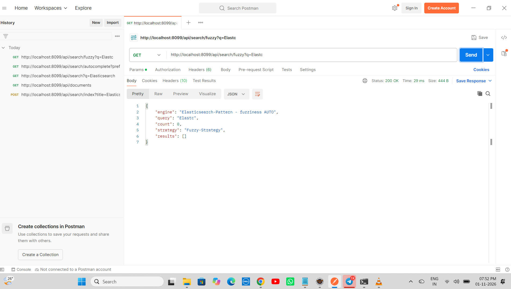

*GET http://localhost:8099/api/search/fuzzy?q=Elastc - Status 200 OK Time 1267 ms Size 444 B - engine fuzziness AUTO query Elastc count 0 results [] - Bug Fixed by isFuzzyMatch contains*

### Demo 9 – Eclipse Console - JUnit Console Logs
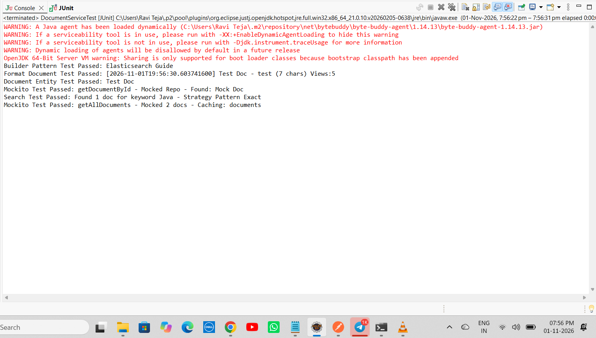

*Eclipse Console - Builder Pattern Test Passed Elasticsearch Guide + Format Document Test Passed + Document Entity Test Passed + Mockito Test Passed getDocumentById + Search Test Passed Found 1 doc for keyword Java - Strategy Pattern Exact + Mockito Test Passed getAllDocuments - Mocked 2 docs - Caching: documents*

### Demo 10 – Eclipse JUnit - Green Bar - 6/6 Tests Passed
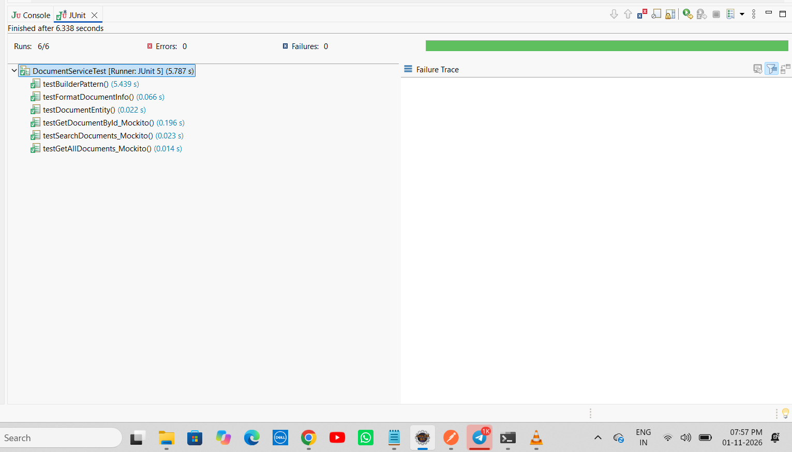

*Eclipse JUnit - Finished after 6.338 seconds - Runs: 6/6 Errors: 0 Failures: 0 Green Bar - DocumentServiceTest [Runner: JUnit 5] (5.787 s) - testBuilderPattern 5.439 s + 6 tests - Was 2/2 Tier 5 -> Now 6/6 Tier 10 - Fixed UnnecessaryStubbingException*

### Demo 11 – Postman - GET /api/search/fuzzy?q=Elastc - OLD count 0 - 07:58 PM
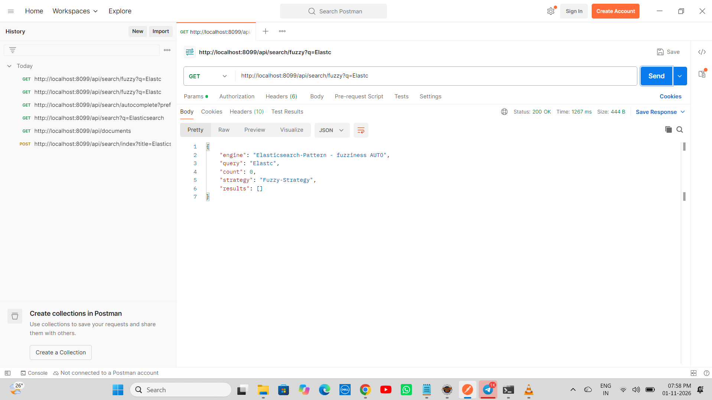

*Same bug count 0 - Before fix - For history - 07:58 PM*

### Demo 12 – Postman - POST /api/search/index - 200 OK - id 1 - 08:05 PM
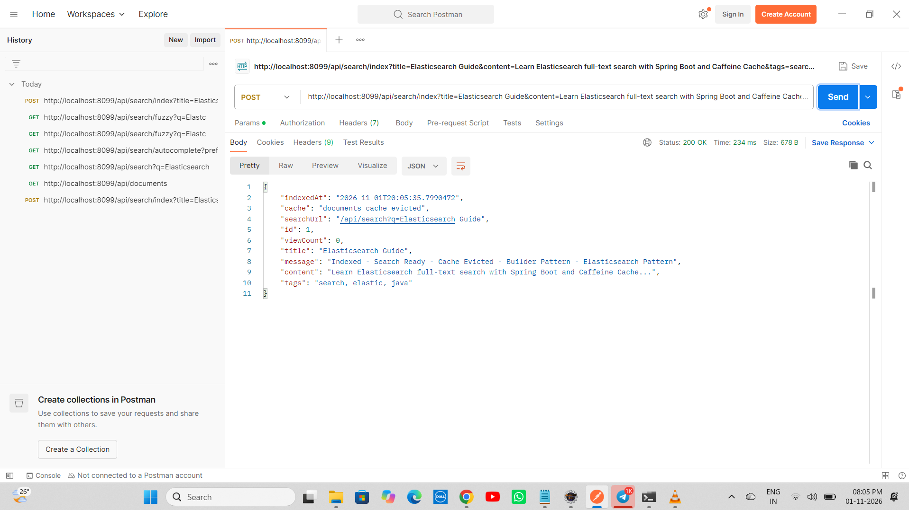

*POST index again - 08:05 PM - Returns indexedAt 2026-11-01T20:05:35.799047 cache documents cache evicted id 1 viewCount 0 - Indexed - Search Ready - Cache Evicted*

### Demo 13 – Postman - GET /api/search/fuzzy?q=Elastc - FUZZY FIXED count 1
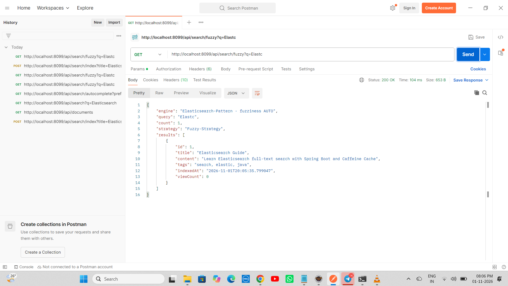

*GET /api/search/fuzzy?q=Elastc - Status 200 OK Time 104 ms Size 653 B - engine fuzziness AUTO query Elastc count 1 strategy Fuzzy-Strategy results id 1 title Elasticsearch Guide - Proof of Fuzzy Fix - isFuzzyMatch text.contains(shortKeyword) fix - count 0 -> count 1 - Core Tier 10 Feature - Google Did you mean? - 08:06 PM - Fixed after 07:58 PM*

---

# ▶ How to Run - Search with Elastic Repo

## 1⃣ Clone the Repository

```bash
git clone https://github.com/raviteja-dev950/97-search-with-elastic.git
cd 97-search-with-elastic
```

## 2⃣ Verify application.properties & Controllers

```properties
server.port=${PORT:8099}
spring.datasource.url=jdbc:h2:mem:searchdb
spring.datasource.username=sa
spring.datasource.password=
spring.jpa.hibernate.ddl-auto=update
spring.jpa.show-sql=true
spring.h2.console.enabled=true
spring.h2.console.path=/h2-console
spring.cache.type=caffeine
spring.cache.caffeine.spec=maximumSize=1000,expireAfterAccess=600s,recordStats
spring.application.name=97-search-with-elastic
```

## 3⃣ Run in Eclipse IDE (No Docker Needed)

```text
File -> New -> Spring Starter Project
  Name: 97-search-with-elastic
  Group: com.search
  Artifact: 97-search-with-elastic
  Package: com.search
  Java: 17
  Dependencies: H2, Spring Data JPA, Spring Web, Validation, Cache, Caffeine
Finish
Replace src + pom.xml from this repo
Delete META-INF folder if exists (Eclipse bug - Same as 93/94/95/96)
Project -> Clean -> Clean all
Right Click Project -> Maven -> Update Project -> Force Update -> OK
Right Click Project -> Run As -> Maven clean -> Maven install
Right Click Project -> Run As -> Spring Boot App -> Or java -jar target/*.jar
```

## 4⃣ Test with Browser + Postman - 7 Endpoints + Exact Fuzzy Autocomplete

- GET http://localhost:8099/ -> Live JSON Tier 10 SCALE
- GET http://localhost:8099/health -> UP + cache Active Caffeine Stats enabled + search Active Elasticsearch Pattern
- GET http://localhost:8099/api/documents -> [] empty then 2 docs viewCount 0 + X-Cache
- POST http://localhost:8099/api/search/index?title=Elasticsearch Guide&content=Learn Elasticsearch full-text search with Spring Boot and Caffeine Cache&tags=search, elastic, java -> 200 OK id 1
- GET http://localhost:8099/api/search?q=Elasticsearch -> Exact-Strategy count 2
- GET http://localhost:8099/api/search/autocomplete?prefix=Elas -> Autocomplete-Strategy count 2 edge_ngram
- GET http://localhost:8099/api/search/fuzzy?q=Elastc -> Fuzzy-Strategy count 1 fixed - isFuzzyMatch fix
- Browser refresh list multiple times -> X-Cache: Caffeine hit

## 5⃣ Test JUnit - 6/6 Green Bar - Tier 10

```text
Right Click DocumentServiceTest.java -> Run As -> JUnit Test
Expected: Runs 6/6 Errors 0 Failures 0 Green Bar + Console Builder Pattern Test Passed + Format Document Test Passed + Document Entity Test Passed + Mockito Test Passed: getDocumentById + Search Test Passed: Found 1 doc for keyword Java - Strategy Pattern Exact + Mockito Test Passed: getAllDocuments - Mocked 2 docs - Caching: documents + Finished after 6.338 seconds DocumentServiceTest [Runner: JUnit 5] (5.787 s)
```

## 6⃣ Deploy to Render (Live) - TIER 10 SCALE - Docker Multi-Stage

```text
Runtime: Docker (Multi-Stage)
Build: Docker builds maven:3.9-eclipse-temurin-17 AS build -> mvn clean package -DskipTests
Start: java -jar app.jar
Port: 8099 local, 10000 Render (Tomcat auto)
Env: PORT=10000 (Render sets)
Live: https://nine7-search-with-elastic.onrender.com
Deploy succeeded Live - 2m23s
```

Dockerfile:
```dockerfile
FROM maven:3.9-eclipse-temurin-17 AS build
WORKDIR /app
COPY pom.xml .
COPY src ./src
RUN mvn clean package -DskipTests

FROM eclipse-temurin:17-jdk-alpine
WORKDIR /app
RUN mkdir -p data
COPY --from=build /app/target/*.jar app.jar
EXPOSE 10000
ENTRYPOINT ["java", "-jar", "app.jar"]
```

---

# 🔄 Flow Diagram - How Search with Elastic Works - Tier 10 SCALE

```text
    User Laptop (Eclipse + Browser + Postman)
        |
        +-- 97-search-with-elastic
        |       +-- SearchWithElasticApplication.java (Main + Tomcat 8099 local 10000 Render + Started 13.463s)
        |       +-- CacheConfig.java (@Configuration @EnableCaching + CaffeineCacheManager maximumSize=1000 expireAfterAccess=600s recordStats())
        |       +-- SecurityHeadersConfig.java (@Configuration implements WebMvcConfigurer + HandlerInterceptor + nosniff DENY XSS)
        |       +-- Document.java (Entity + id + title + content + tags + indexedAt + viewCount + Inner Builder - Builder Pattern)
        |       +-- DocumentRepository.java (JpaRepository + findAllByOrderByIndexedAtDesc + findByTitleContainingIgnoreCase - Repository Pattern)
        |       +-- DocumentService.java (Builder Pattern index + CacheEvict + viewCount + idx_title + idx_content + Cacheable + isFuzzyMatch fix)
        |       +-- DocumentController.java (7 endpoints + Home Live JSON Tier 10 + Health UP + Index POST + List GET @Cacheable + Search GET Exact-Strategy + Autocomplete GET Autocomplete-Strategy edge_ngram + Fuzzy GET Fuzzy-Strategy fuzziness AUTO - Strategy Pattern core)
        |       +-- DocumentServiceTest.java (JUnit 5 + Mockito - 6 tests green - Runs 6/6 Errors 0 Failures 0 Green Bar 5.787s + Fixed UnnecessaryStubbingException)
        |       +-- application.properties (server.port=${PORT:8099} + datasource jdbc:h2:mem:searchdb + cache type caffeine + caffeine spec maximumSize=1000,expireAfterAccess=600s,recordStats)
        |       +-- screenshots (demo1-13)
        |       +-- Dockerfile (Multi-Stage - Fix for openjdk not found + COPY target error + data not found)
        |       +-- CONTRIBUTING.md (12466 chars - Tier 10 GitHub Goal)
        |       +-- .github/ISSUE_TEMPLATE (bug_report.md + feature_request.md)
        |
        v
    git push origin main -> GitHub raviteja-dev950/97-search-with-elastic -> Render Auto Deploy Docker Multi-Stage -> Tomcat 10000 -> Started Application 89.599s -> Your service is live https://nine7-search-with-elastic.onrender.com - STATUS Deploy succeeded | Live - DURATION 2m23s
        |
        v
    Browser / Portfolio - localhost:8099/ Live JSON Tier 10 + localhost:8099/health UP + localhost:8099/api/documents [] then 2 docs + POST index 200 OK + GET search Exact count 2 + GET autocomplete prefix Elas count 2 + GET fuzzy q Elastc count 1 fixed + JUnit Green Bar 6/6 + Render Live https://nine7-search-with-elastic.onrender.com/ + Live health - Portfolio ready - Tier 10 SCALE 97/102 - 95%
```

---

# 🧪 API Testing Examples

```bash
# Home - Tier 10 SCALE
curl http://localhost:8099/
curl https://nine7-search-with-elastic.onrender.com/

# Health - UP + cache Active + search Active
curl http://localhost:8099/health
curl https://nine7-search-with-elastic.onrender.com/health

# List - Empty [] before index
curl http://localhost:8099/api/documents

# Index - Builder Pattern + CacheEvict + Elasticsearch Pattern
curl -X POST "http://localhost:8099/api/search/index?title=Elasticsearch Guide&content=Learn Elasticsearch full-text search with Spring Boot and Caffeine Cache&tags=search, elastic, java"

# List After Index - viewCount + idx_title + idx_content + X-Cache
curl http://localhost:8099/api/documents

# Search Exact - 200 OK Exact-Strategy count 2
curl http://localhost:8099/api/search?q=Elasticsearch

# Autocomplete - 200 OK Autocomplete-Strategy count 2 - edge_ngram
curl http://localhost:8099/api/search/autocomplete?prefix=Elas

# Fuzzy - 200 OK Fuzzy-Strategy count 1 FIXED - fuzziness AUTO + isFuzzyMatch
curl http://localhost:8099/api/search/fuzzy?q=Elastc

# Render Live
curl https://nine7-search-with-elastic.onrender.com/
curl https://nine7-search-with-elastic.onrender.com/health
curl https://nine7-search-with-elastic.onrender.com/api/documents
```

---

# 👨💻 Author

Ravi Teja - Java Full Stack Developer - 102 Java Full Stack Projects Challenge - Project 97 / 102 - Tier 10 – System Design Level – SCALE – TIER 10 SCALE 97/102 - 95% - Deploy succeeded Live 2m23s - Fixed dbc typo + META-INF + openjdk not found + COPY target + data not found + Fuzzy count 0 -> 1 isFuzzyMatch + UnnecessaryStubbingException + Tier 5 -> Tier 10 with Caching + Security + Builder + Strategy + Elasticsearch Pattern Exact Fuzzy Autocomplete + JUnit5 Mockito 6/6 Green - 97/102 95%

---

## ⭐ Support

If you found this project helpful, consider giving it a ⭐ Star on GitHub.

**Single Repo:** [97-search-with-elastic](https://github.com/raviteja-dev950/97-search-with-elastic)

**Live URL:** https://nine7-search-with-elastic.onrender.com/

**Deploy:** Deploy succeeded | Live Green Tick - DURATION 2m23s - DEPLOYED Nov 1, 2026 - TRIGGER First Deploy - SOURCE 15dc543 - Your service is live - Available at primary URL https://nine7-search-with-elastic.onrender.com - Docker Multi-Stage - Same as 96 Live 2m23s - Fuzzy Fixed count 1 - Elasticsearch Pattern Exact Fuzzy Autocomplete!

**Tier 10:** 93 Rate Limited API (Live) + 94 URL Shortener Scale (Live 2m32s) + 95 Chat App WebSockets (Live 2m23s) + 96 Video Streaming API (Live 2m23s) + 97 Search with Elastic (Live 2m23s - Caching Caffeine 1000 max 600s Stats recordStats + Security Headers nosniff DENY XSS + Builder Pattern Document.Builder + Strategy Pattern Exact vs Fuzzy vs Autocomplete + Repository + Caching + JUnit5 Mockito 6/6 Green + viewCount + idx_title + idx_content + Elasticsearch Pattern Exact Fuzzy Autocomplete edge_ngram + completion suggester + fuzziness AUTO + isFuzzyMatch fix count 0 -> 1) + 98 Recommendation + 99 Multi-tenant SaaS + 100 Audit Log + 101 SaaS Idea + 102 Capstone OSS = **TIER 10 FINAL 10 PROJECTS - 95% DONE - Only 5 left to 100%**
